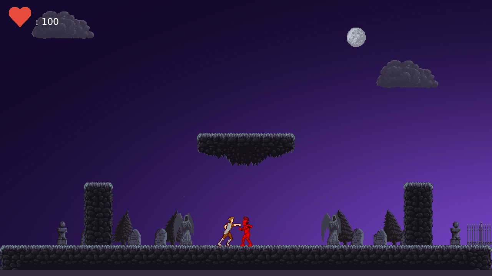
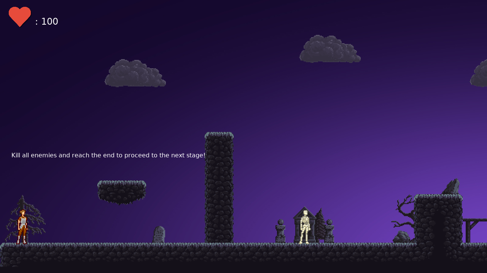
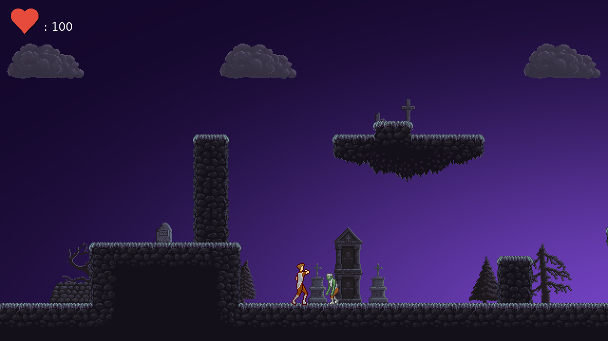
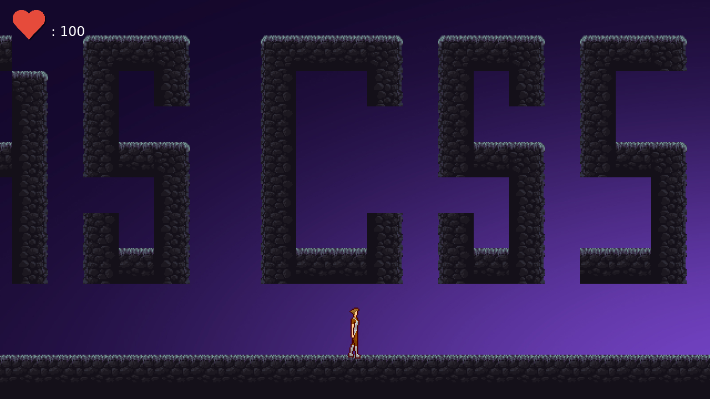

# Wilderness

[](https://github.com/aalatraqchi/Wilderness/actions/workflows/ci.yml)
[](LICENSE)

A 2D combat platformer built with Lua and the LÖVE framework.

Fight through four graveyard stages full of skeletons, goblins, and centurions. Every enemy on a stage must be defeated before the exit opens, and timing attacks against guards is the key to surviving.



**Gameplay video:** [watch on YouTube](https://www.youtube.com/watch?v=hsxekIqpdtU)

## Features

- **Melee Combat:** Standing and crouching attacks, a guard that blocks incoming damage, and red hit flashes on both the player and enemies.
- **Platforming:** Acceleration and friction based movement, gravity, double jump, and crouching, all driven by the Box2D physics engine.
- **Three Enemy Types:** Skeletons, goblins, and centurions, each with their own health, speed, damage, and attack timing.
- **Enemy AI:** Enemies guard an area, chase the player who enters it on the same level, and attack in timed windows the player can punish.
- **Four Stages:** Levels designed in Tiled and loaded at runtime, with enemy spawn points placed in the map files.
- **Stage Progression:** Each stage tracks kills and only lets the player advance once every enemy is defeated.
- **Animation & Audio:** Sprite sheet animations for every character, background music, and sound effects for footsteps, hits, and deaths.
- **Automated Smoke Test:** A headless run in CI that boots the game and plays through every stage.

## Tech Stack

- **Language:** Lua (LuaJIT)
- **Framework:** LÖVE 11.5
- **Physics:** Box2D (built into LÖVE)
- **Level Design:** Tiled, loaded with Simple Tiled Implementation (STI)
- **Libraries:** anim8 (sprite animation), cron.lua (timed events)
- **CI:** GitHub Actions

## Screenshots

| Stage 1 | Goblin fight | Final stage |
| --- | --- | --- |
|  |  |  |

## Getting Started

1. Install [LÖVE 11.5](https://love2d.org/).
2. Clone the repository:

   ```bash
   git clone https://github.com/aalatraqchi/Wilderness.git
   cd Wilderness
   ```

3. Run the game from the repository root:

   ```bash
   love .
   ```

   On Windows, drag the `Wilderness` folder onto `love.exe`, or run `"C:\Program Files\LOVE\love.exe" .`

### Controls

| Key | Action |
| --- | --- |
| `A` / `D` | Move left / right |
| `W` or `Space` | Jump (press again in the air to double jump) |
| `S` | Crouch |
| `J` | Attack |
| `K` | Guard |

## Testing

Run the headless smoke test, which boots the game, plays through all four stages, and exits with a non-zero status on any error:

```bash
love . --smoke
```

On a machine without a display, use a virtual one:

```bash
SDL_AUDIODRIVER=dummy xvfb-run -a love . --smoke
```

The same test runs in GitHub Actions on every push and pull request.

## Current Scope

Wilderness is a complete four-stage game for a single player using a keyboard. Gamepad support, save data, and a title or pause menu are not currently implemented. When the player's health reaches zero, they respawn at the start of the current stage.

## Documentation

- [Architecture](docs/ARCHITECTURE.md): game loop, module layout, physics, maps, and enemy design
- [Development Story](docs/DEVELOPMENT-STORY.md): how the game was designed and built
- [Credits](docs/CREDITS.md): art, audio, tutorials, and third-party libraries

## License

The game code is released under the [MIT License](LICENSE). Bundled libraries, art, and audio belong to their respective authors; see [Credits](docs/CREDITS.md).
